<div align="center">

# Sai_Rotbots

**Open-Source Embodied Robotics Engineering — Interactive Bipeds, Dual-Arm Humanoids & Wheel-Leg Cargo Platforms**

[](robots/goose_v0_2/README.md)
[](robots/goose_v0_2/models/full/goose_v02_005_exterior_roles_v1/)
[](robots/goose_v0_2/hardware/closeout_20261125/environment_board_eda_fab_release_003/)
[](LICENSE)

[Goose V0.2](#goose-v02) ·
[Gorilla V0.1](#gorilla-v01) ·
[Goose V0.1](#goose-v01) ·
[Sai_Agent 001 / 002](#sai-agent-001-002) ·
[Quick Start](#quick-start) ·
[Repository Architecture](#project-organization)

</div>

---

面向真实世界互动与任务的开源机器人工程。仓库由 `Sai_Agent_001` 直接改名（保留完整提交历史、Goose V0.1 与旧版本发布），现统一维护五款机器人平台：从旗舰互动双足 **Goose V0.2**、探索性 2.65 m 双足双手 **Gorilla V0.1**、长颈衔取原型 **Goose V0.1**，到轮腿载货机器人 **Sai_Agent_002** 与保留原装对夹皮带的 **Sai_Agent_001**。

## 🤖 Robot Family Overview

| Robot ID | Stage & Role | Key Mechanism / Highlights | Dedicated Page |
|---|---|---|---|
| **`goose_v0_2`** | **Flagship Digital Hardware Closeout (`assembly_finish_005`)** | 18.768 kg · 18 active DOF · 310 mm stance · Al 7075-T6 anchored hip bridge (`opt_b2_r2`, 8/8 FEA gates PASS) · 0-DRC 6L PCB · 43-collider SaiLab GPU bundle (`1,330.2 world-steps/s`) · MicroDuck 4-Colorway Theme | **[Goose V0.2 →](robots/goose_v0_2/README.md)** |
| **`Goose_V0.1`** | Long-neck interactive biped prototype | Parallel four-bar gripping beak (`Untitled Goose Game` × `MicroDuck`); 11-collider Sim2Sim task proxy (MuJoCo + Rapier) & initial training checkpoint | **[Goose V0.1 →](robots/Goose_V0.1/README.md)** |
| **`gorilla_v0_1`** | Exploratory 2.65 m biped & dual-arm layout | AA3 four-view appearance baseline; C15 segmented-foot (forefoot/arch/heel) stage, physical gates open | **[Gorilla V0.1 →](robots/gorilla_v0_1/README.md)** |
| **`Sai_Agent_002`** | Flat-bed wheel-leg cargo platform | Front SO101 arm + four wheel-legs + continuous flat open cargo bay (contact-only passive transport, Godot 4.7.2 ready) | **[Sai_Agent_002 →](robots/Sai_Agent_002/README.md)** |
| **`Sai_Agent_001`** | Original wheel-leg platform *(default `--robot`)* | Preserved original powered opposed cargo pads and belt clamping mechanism (Godot 4.7.2 ready) | **[Sai_Agent_001 →](robots/Sai_Agent_001/README.md)** |

---

<a id="goose-v02"></a>
## 🦢 Goose V0.2 — Flagship Digital Hardware Closeout (`assembly_finish_005`)

**Goose V0.2** is our "Max Pro" MicroDuck-inspired interactive biped: expressive long-neck kinematics, a real parallel four-bar gripping beak, a widened 310 mm dynamic stance, and a full cold-verified digital hardware stack (`CAD + C3D10 FEA + 0-DRC 6L PCB + 24 V Thermal OVP + 21-Body MCI + 43-Collider GPU RL/VLA Bundle`).

### One-Glance Technical Poster

[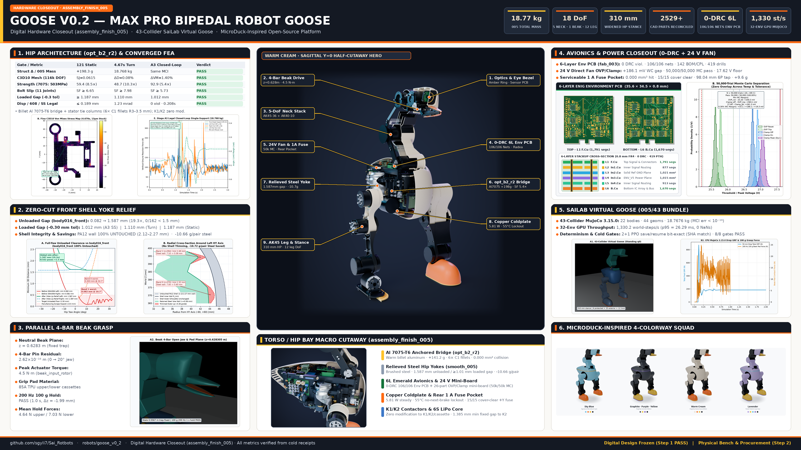](robots/goose_v0_2/images/closeout_20261125/goose_v02_flagship_poster.png)

### Inside & Out — Half-Cutaway Architecture (`Warm Cream` Flagship Edition)

| Half-Cutaway / Half-Exterior Studio Hero | Internal Hip Bridge (`opt_b2_r2`) & Core Packaging |
|---|---|
| 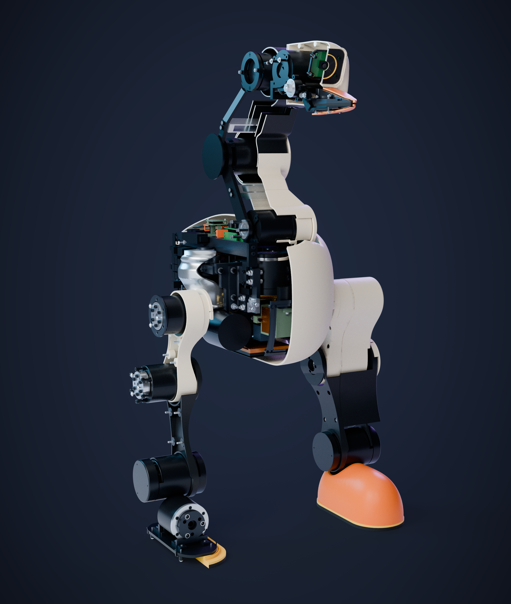 | 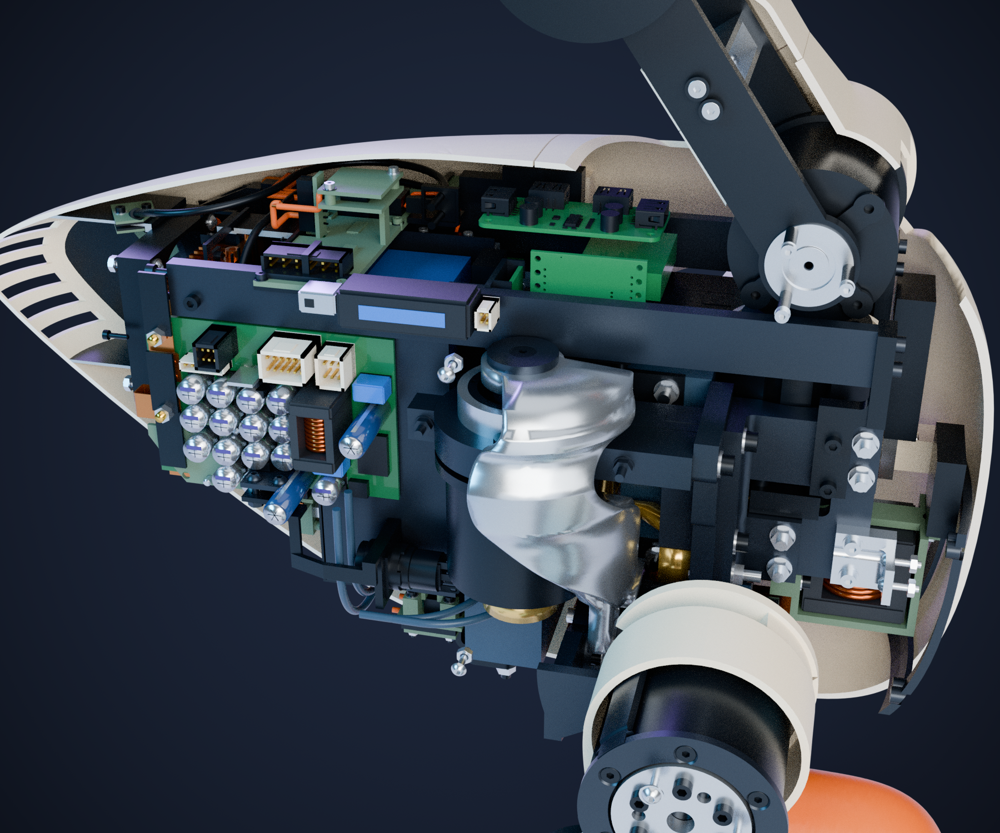 |

*Real `assembly_finish_005` geometry rendered directly from CAD: the exterior half showcases our flagship **Warm Cream (`#F2E5CF`)** ivory goose shell + tangerine orange (`#FF6A13`) beak & shoes + golden amber (`#FFC32B`) eye ring & sole trim; the cutaway half exposes the machined steel hip yokes, anchored Al 7075-T6 `opt_b2_r2` lower bridge & stator tie columns, 6-layer green environment PCB, 24 V direct cooling fan, copper coldplate, AK45 actuators, and 6S LiPo power stack.*

### MicroDuck-Style 4-Colorway Theme Suite (`Sky · Graphite · Cream · Lavender`)

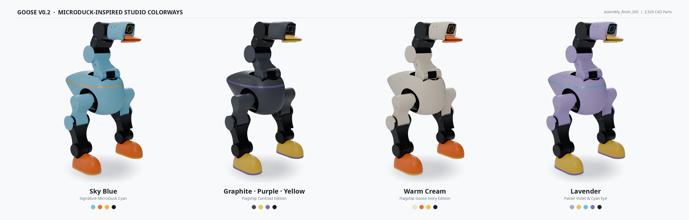

*Four matched studio themes built on identical `assembly_finish_005` geometry with restrained neutral caps and a bespoke Rolls-Royce-inspired twin torso coachline on Sky (`#FFB81C` gold), Graphite (`#845EC2` electric purple), and Lavender (`#55C4E8` cyan), alongside pure unstriped flagship Warm Cream ([theme config JSON](robots/goose_v0_2/configs/microduck_four_colorways_005.json) · [2×2 close-up grid](robots/goose_v0_2/images/closeout_20261125/goose_v02_four_colorways_grid.png) · [design review record](robots/goose_v0_2/evidence/closeout_20261125/showcase_design_review_20261126.json)).*

### Digital Closeout Scorecard (`assembly_finish_005`, 2026-11-25)

| Subsystem | Cold-Verified Milestone | Key Quantitative Evidence | Status |
|---|---|---|---|
| **Hip Lower Bridge (`opt_b2_r2`)** | Al 7075-T6 anchored lower cross-bridge + stator tie columns (`141.19 g`, `0.000 mm³` collision; K1/K2/cassette untouched) | 3-level C3D10 mesh (`min SJ = 0.0615`, `ΔDisp = 0.08%`, `ΔVM = 1.40%`); `121/121` static `<= 0.1893 mm` (`59.4 MPa`); Closed-loop MuJoCo single-support (`312.1 N`, `0.208 s`, `+36.4 mm` lift) **`92.9 MPa (SF = 5.4)`**, `SF_slip = 5.73`, `2.096 mrad` | **8/8 PASS** |
| **Front Shell Clearance** | Zero-cut `body016_front` (`2.12–2.27 mm` PA12 preserved) via low-stress outer-lip relief on steel yokes (`-10.66 g/pair`) | 162-pose unloaded gap **`0.0823 → 1.5869 mm`** (19.3×); loaded gap with `-0.30 mm` tol **`1.012 / 1.212 mm`** (`> 0.50 mm`) | **PASS** |
| **6L Environment Mainboard** | `eda_fab_release_003` self-contained KiCad 7.0.11 (`ENV_MAIN.pretty` + refilled GND/ENV_V5 planes) | **`0` native DRC violations**, `106/106` nets, `0` dangling copper, `0` library warnings; 13 Gerbers + 419-PTH Excellon + 142-part BOM/CPL verified | **FAB READY** |
| **24 V Direct Fan & Fuse** | Precision input OVP (`LM4040A25`/`TLV1811`) + shifted backfeed clamp + rear-cover `UMT-H 1 A` serviceable fuse pocket | **`+186.1 mV`** strict corner guardband, **`50,000/50,000` (100%)** Monte Carlo, `0.000 mm³` collision (`36.7 mm` pull clearance), net `+9.60 g` | **DIGITAL PASS** |
| **21-Body MCI & SaiLab 43-Collider** | `goose_v02_005_exterior_roles_v1` fast RL/VLA bundle (fixed `0.628305 m` beak neutral plane, `0` self-contacts) | **`18.767646 kg`** (Steiner `1.11e-15 kg·m²`), CPU 200 Hz `100 g` 1.0 s hold PASS, GPU 32-env **`1,330.2 world-steps/s`** (`0` NaNs, bit-identical PPO resume) | **8/8 PASS** |

> **Step-2 Physical Build Scope (Transparently Deferred)**: Real-world fabrication, thermocouple thermal soak (`54.996 °C` sim margin), BMS upper-rail `10.207 mm³` CNC relief, and physical mass/friction bench calibration are deferred to Step 2 while we advance virtual Goose RL/VLA locomotion and community demos first.

**Direct Goose V0.2 Links:**
[Goose V0.2 Dedicated Page](robots/goose_v0_2/README.md) ·
[Closeout Engineering Spec](robots/goose_v0_2/design/hardware_closeout_20261125.md) ·
[43-Collider SaiLab Model](robots/goose_v0_2/models/full/goose_v02_005_exterior_roles_v1/) ·
[Frozen CAD STEP](robots/goose_v0_2/cad/exports/closeout_20261125/) ·
[0-DRC 6L PCB Package](robots/goose_v0_2/hardware/closeout_20261125/environment_board_eda_fab_release_003/) ·
[24 V Fan & Fuse](robots/goose_v0_2/hardware/closeout_20261125/sanyo24_direct_fan/) ·
[Verification Receipts](robots/goose_v0_2/evidence/closeout_20261125/) ·
[Design Review Record](robots/goose_v0_2/evidence/closeout_20261125/showcase_design_review_20261126.json) ·
[Historical 038 / Frozen 15 Lineage](robots/goose_v0_2/README.md#historical-lineage)

---

<a id="gorilla-v01"></a>
## 🦍 Gorilla V0.1 — AA3 Biped & Dual-Arm (C15 Stage)

Gorilla 以用户确认的 AA3 四视图为唯一外观基准，原图比例优先、高度暂取 `2.65 m`；目标是双足移动、双手操作与自主复杂任务。当前 [C15 阶段基底](robots/gorilla_v0_1/design/appearance_c15_stage.md) 保存实际外壳、有限壁厚主框架和分段前掌／足弓／后跟；已提供同源可编辑模型、七机位实渲及有界几何检查。

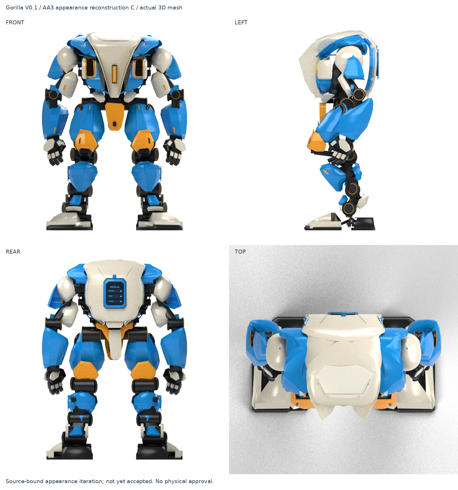

这是一份可回退的探索候选，外观、完整内部装配、锁止承力和稳定物理合同仍未放行。历史 B 的运行模型与 C15 显示几何分别保留版本；Gorilla 不使用现有轮腿控制器或策略，Bevy 原生物理任务尚待后续验证。下一阶段先闭合真实内部模块的质量、空间、输出、供电与热预算，再细化壳体。详见 **[Gorilla V0.1 导航页](robots/gorilla_v0_1/README.md)**。

---

<a id="goose-v01"></a>
## 🪿 Goose V0.1 — Untitled Goose Game × MicroDuck Origin

Goose 系列的初衷来自 [Untitled Goose Game](https://goose.game/)：把鹅的好奇、探头、歪头、回望、动作停顿和叫声带进真实世界，也让它能帮人做小事。**叼起物品和拖拽物体同等重要**；目标包括指定轻量日用品、布边、空拖鞋、轻篮及小车，支持遥控和“叼过来／拖到指定位置／放下”的指定物自主任务。

我们将它视作 [MicroDuck](https://github.com/pollen-robotics/microduck) 的“Max Pro”方向：借鉴双足互动机器人的经验，增加头颈活动范围、真实嘴部夹持和腿脚机动。外观追求简约的鹅感，以可打印曲面、大眼、橙色嘴脚和两侧手动检修门表达角色；检修门不画写实羽毛。

| Goose V0.1 手动翼门工程装配 (`Cream`) | 11 碰撞体 Sim2Sim 任务代理 (`task_proxy_11_v1`) |
|---|---|
| 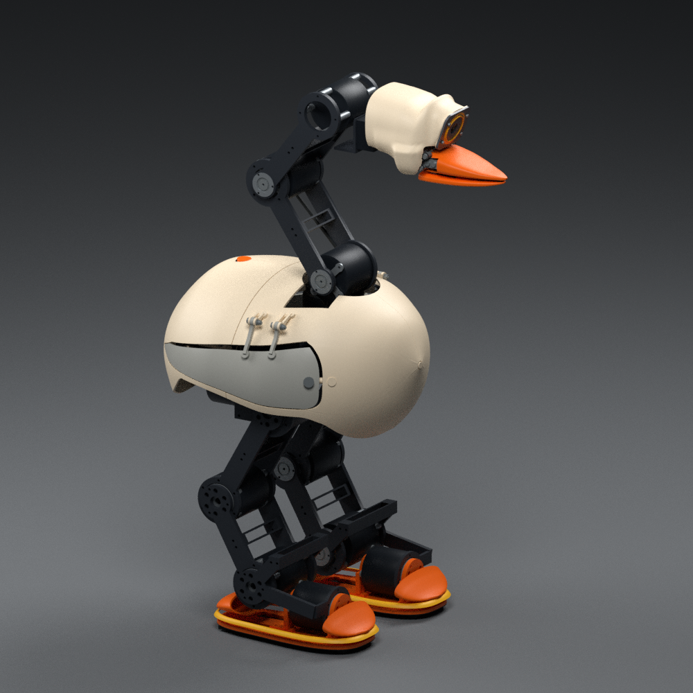 | 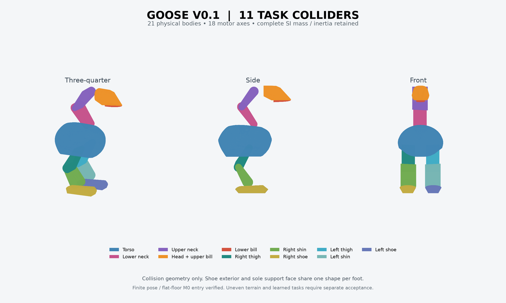 |

**直接查看：** [Goose V0.1 资料入口](robots/Goose_V0.1/README.md) · [11 碰撞体任务代理说明](robots/Goose_V0.1/design/task_proxy_11_v1.md) · [碰撞体文件目录](robots/Goose_V0.1/models/task_proxy_11_v1/) · [同版入口与契约](robots/Goose_V0.1/configs/task_proxy_11_v1_entry.json) · [Bevy 独立接收器](integrations/bevy/goose_task_proxy/README.md) · [Git LFS 拉取说明](docs/guides/large_asset_checkout.md)

<details>
<summary>📂 展开 Goose V0.1 四色对比、外观演进与历史硬件检查点（478 件 / 制动 / 采购说明）</summary>

<br>

上图直接来自 **478 件候选源装配**（18 个主动轴、约 `10.40 kg` 条件质量、闭合零位包围约 `43.4 × 26.7 × 64.2 cm`），不是实物照片或最终制造验收图。

| Cream 奶油白 | Graphite 石墨灰 | Lavender 薰衣草紫 | Sky 天空蓝 |
|---|---|---|---|
|  | 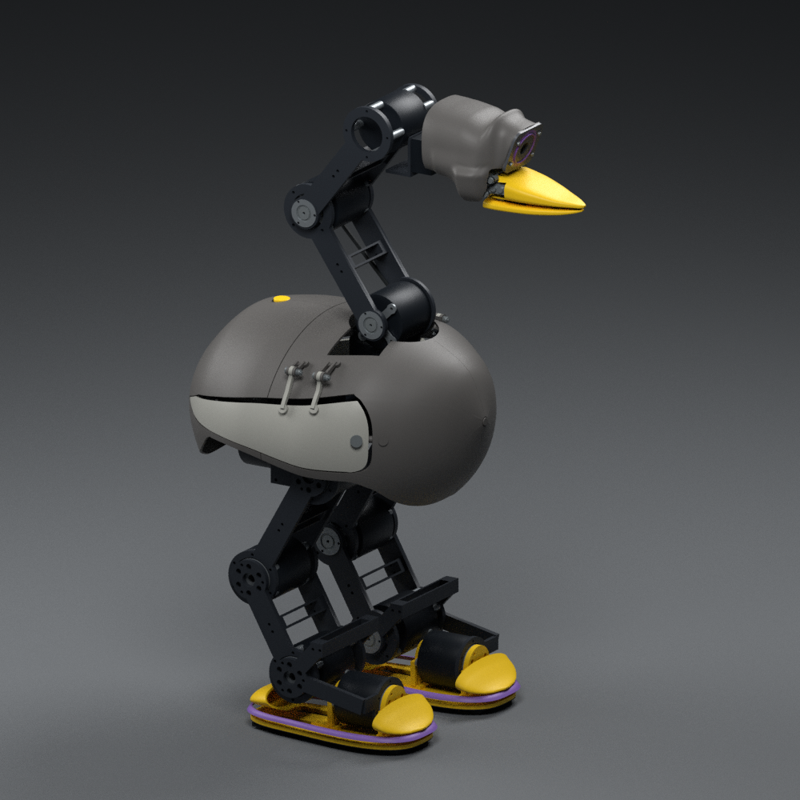 | 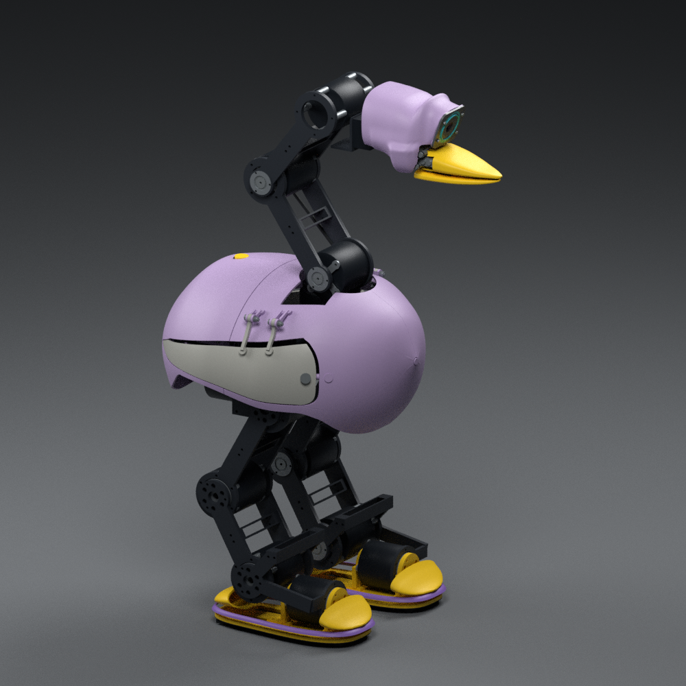 | 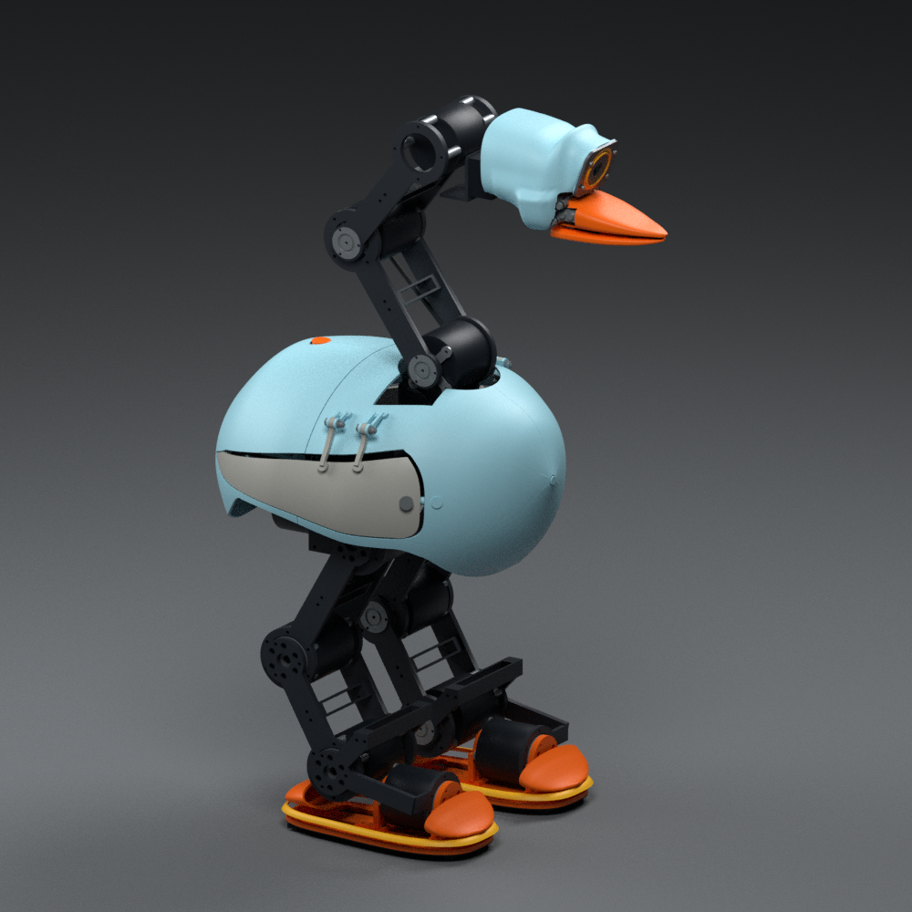 |

四款使用同版几何、同镜头与灯光；见 [配色与源身份记录](robots/Goose_V0.1/design/manual_wing_service_checkpoint.md)。

| 早期 R2 尖嘴概念 | 已确认的阶段性外观基线 |
|---|---|
| 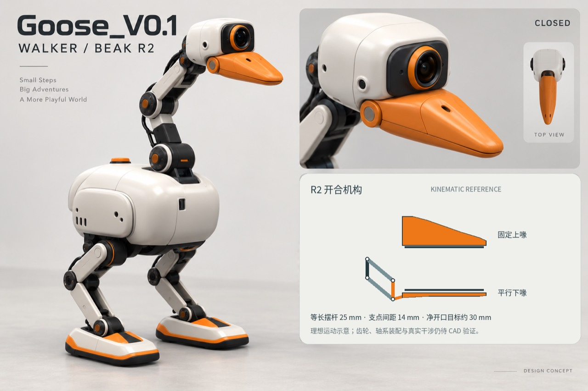 | 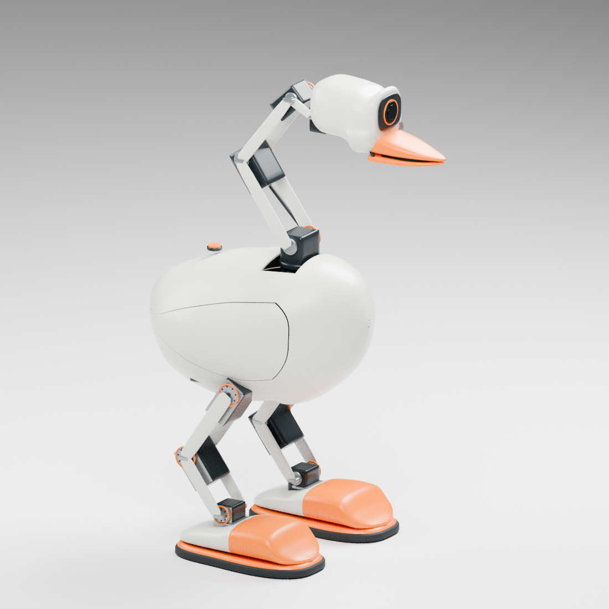 |

右侧 [外观基线](robots/Goose_V0.1/design/fuller_exterior_review.md) 曾获阶段性确认；概念图上的旧尺寸与性能不作为当前工程参数。

- **Sim2Sim 任务代理**：MuJoCo 与原生 Rapier 各完成 2,500 次实际积分，通过冷启动、站立、有限关节动作、嘴部行程和负载／摩擦检查（18 项动作、65 项基础观测及 82 项指定物扩展供 `Sai_Lab` 绑定；Godot/Jolt、Unity 仍需各自验证）。
- **历史硬件与制动检查点**：[478 件结构检查点](robots/Goose_V0.1/design/manual_wing_service_checkpoint.md)（003 运行模型绑定原 `10.430690821 kg` 参数）、[精确驱动资料及 18 轴端点](robots/Goose_V0.1/hardware/power_release_checkpoint.md)、[绝对阈值制动电路候选](robots/Goose_V0.1/hardware/absolute_brake_chopper_checkpoint.md) 与 [制动安装比较](robots/Goose_V0.1/hardware/brake_packaging_checkpoint.md)（525 件 / `10.486951740 kg`）均保留；完整线束、翼门连续开合、急停及实测热／载荷仍未闭合，**不可直接按 V0.1 候选 BOM 下单装机**。
- **溯源文档**：[历史 460 件训练交接](robots/Goose_V0.1/design/training_checkpoint_handoff.md) · [单件头壳结构](robots/Goose_V0.1/design/one_piece_head_checkpoint.md) · [行为要求](robots/Goose_V0.1/design/behavior_requirements.md) · [原始资料图片库](robots/Goose_V0.1/design/concepts/index.html) · [导入记录](robots/Goose_V0.1/source/workspace_import.md)。

</details>

---

<a id="sai-agent-001-002"></a>
## 🛞 Sai_Agent_001 & Sai_Agent_002 — Wheel-Leg Cargo Platforms

Both wheel-leg variants retain the front **SO101** manipulator arm, four wheel-legs, camera mounts, and rear touchscreen hardware layout. **Sai_Agent_001** preserves the original powered opposed belt-clamp bay (default `--robot`), while **Sai_Agent_002** provides a continuous flat open cargo floor with contact-only passive transport. Hardware has not been built or calibrated.

| Sai_Agent_002 Actual Model | Flat Open Cargo Surface |
|---|---|
| 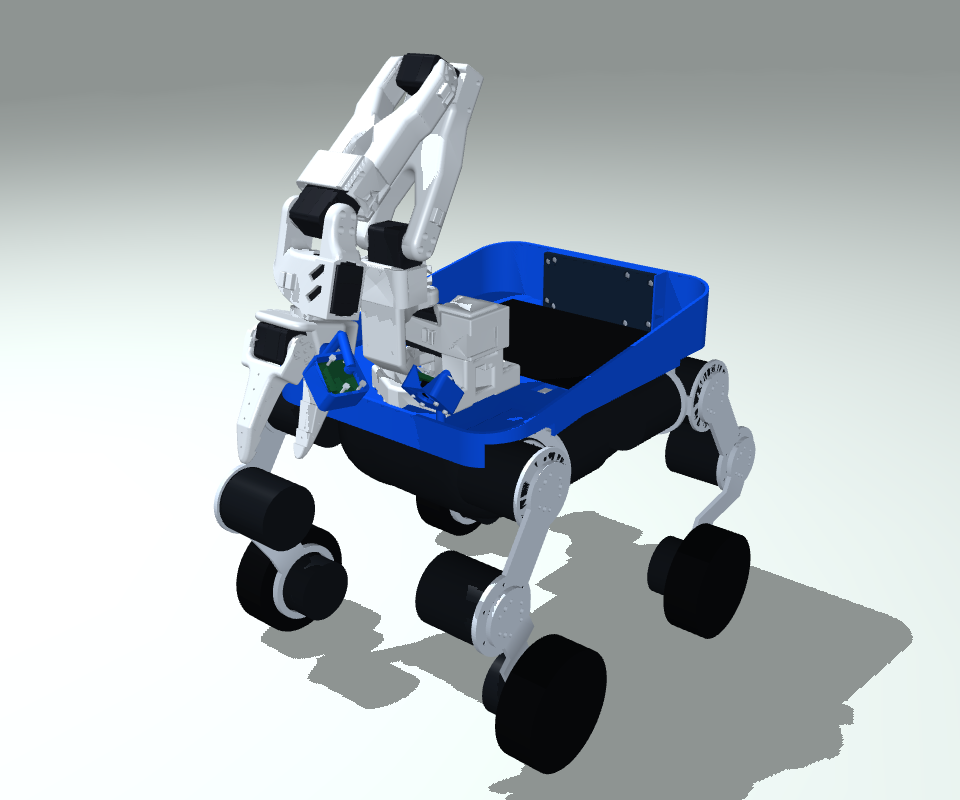 | 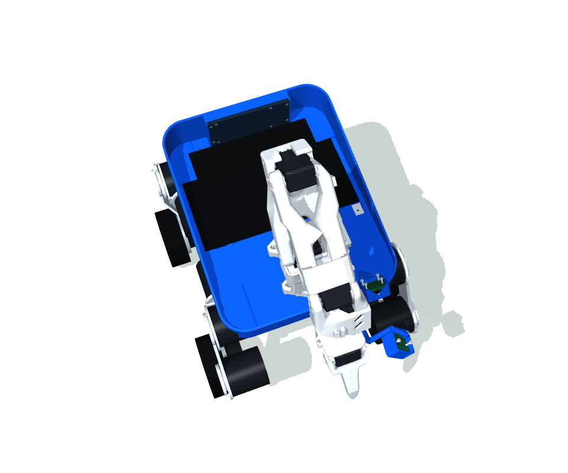 |

- [Sai_Agent_001 Guide](robots/Sai_Agent_001/README.md) · [001 Historical Acceptance](robots/Sai_Agent_001/design/simulation_guide.md)
- [Sai_Agent_002 Scope & Evidence](robots/Sai_Agent_002/README.md) · [Variant Plan](robots/Sai_Agent_002/design/agent_002_plan.md)

---

<a id="quick-start"></a>
## ⚡ Quick Start: Godot 4.7.2, Training & Tests

### Run Wheel-Leg Robots in Godot

Requires Python 3.12, Godot 4.7.2, and `uv`:

```sh
uv sync
uv run sai-agent godot --robot Sai_Agent_002
uv run sai-agent godot --robot Sai_Agent_001
```

**Controls:** `W`/`S` 前进后退 · `A`/`D` 左右转向 · 按住 `Shift` 下蹲、松开恢复 · `R` 重启。Omitting `--robot` preserves the original `Sai_Agent_001` default.

```sh
uv run sai-agent godot --robot Sai_Agent_002 --task cargo
uv run sai-agent godot --robot Sai_Agent_002 --stairs .04
```

*Note:* `Sai_Agent_002` uses contact-only pickup → placement → passive transport with no clamping stage or cargo attachment constraint (objects can slide or fall). Camera images are available, while current tasks use model-state IK and terrain raycasts rather than VLA. The rear touchscreen remains a hardware layout, not implemented firmware.

### Models, Tests, Evaluation & GPU Training

[`robots/catalog.json`](robots/catalog.json) maps stable robot IDs to separate model directories. Shared controllers and policies are retained; the `sai-agent-001` Python package name and `sai_agent` import remain unchanged for integration compatibility. The repository name is `Sai_Rotbots` as requested, including that spelling.

```sh
uv sync --extra test --extra cad --extra assets --extra hardware
uv run pytest -q
uv run python scripts/evaluation/evaluate_flat.py --robot Sai_Agent_002 --policy shared/policies/flat-v1.onnx --full-robot --out artifacts/002-flat --require-pass
uv run --extra train python scripts/training/train.py --robot Sai_Agent_002 --worlds 256 --seconds 300 --name my-002-trial
```

`Sai_Agent_002` reuses existing trained actors checked on its changed mass/contact model (not presented as a newly trained policy). GPU training accepts `--robot` and records the selected model hash and robot ID.

---

<a id="project-organization"></a>
## 📐 Project Organization & Engineering Rules

```text
Sai_Rotbots/
├── robots/
│   ├── catalog.json              # Stable robot IDs & model entrypoints
│   ├── goose_v0_2/               # Flagship Goose V0.2 (005 closeout, 43-collider model, 6L PCB, CAD, renders)
│   ├── Goose_V0.1/               # Goose V0.1 11-collider Sim2Sim proxy & manual-wing CAD
│   ├── gorilla_v0_1/             # Gorilla V0.1 AA3 / C15 exploratory platform
│   ├── Sai_Agent_002/            # Flat-bed wheel-leg robot
│   └── Sai_Agent_001/            # Original belt-clamp wheel-leg robot (default)
├── shared/                       # Cross-robot components, configs & shared policies
├── src/sai_agent/                # Shared control, simulation & resource discovery code
├── scripts/                      # Categorized CLI entrypoints (models, cad, training, evaluation, diagnostics)
├── integrations/                 # Godot & Bevy integrations
├── experiments/                  # Reproducible experiment ledgers & candidate snapshots
├── tests/                        # Automated contract, physics & CAD test suites
├── docs/                         # Guides, architecture, releases & validation records
└── artifacts/                    # Local generated outputs (git-ignored)
```

Read the **[Engineering Rules](sai_robots_engineering_rules.md)** before adding or moving files. See also:
[Directory Migration Record](docs/guides/directory_migration.md) ·
[Game Integration Notes](docs/guides/integrations.md) ·
[Large Asset Checkout (Git LFS)](docs/guides/large_asset_checkout.md) ·
[Third-Party Notices](THIRD_PARTY_NOTICES.md)

### Notices & Acknowledgments

Old `alpha.3` results describe `Sai_Agent_001`, not `Sai_Agent_002`. Unity editor validation remains pending. SO101 and Raspberry Pi derivatives retain their upstream licenses. Supplier CAD with unconfirmed redistribution rights is represented by independent nominal display envelopes. Digital physics parameters are CAD/material-derived engineering estimates until physical bench calibration is completed. Inspired by [MicroDuck](https://github.com/pollen-robotics/microduck)'s functional design philosophy; the wheel-leg cargo chassis and Goose V0.2 hardware architecture are independent designs.
