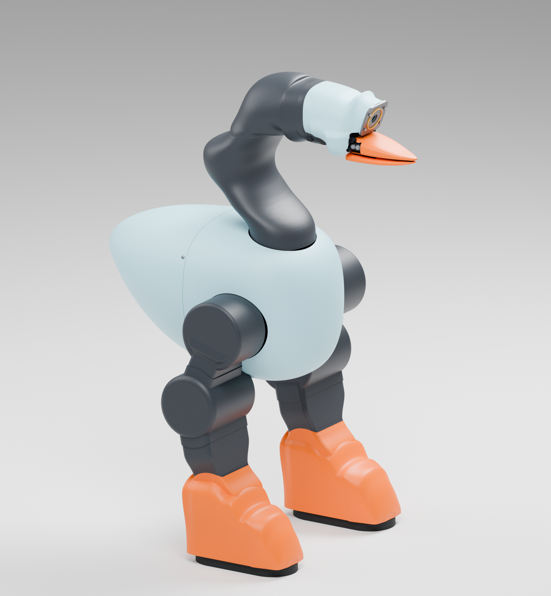
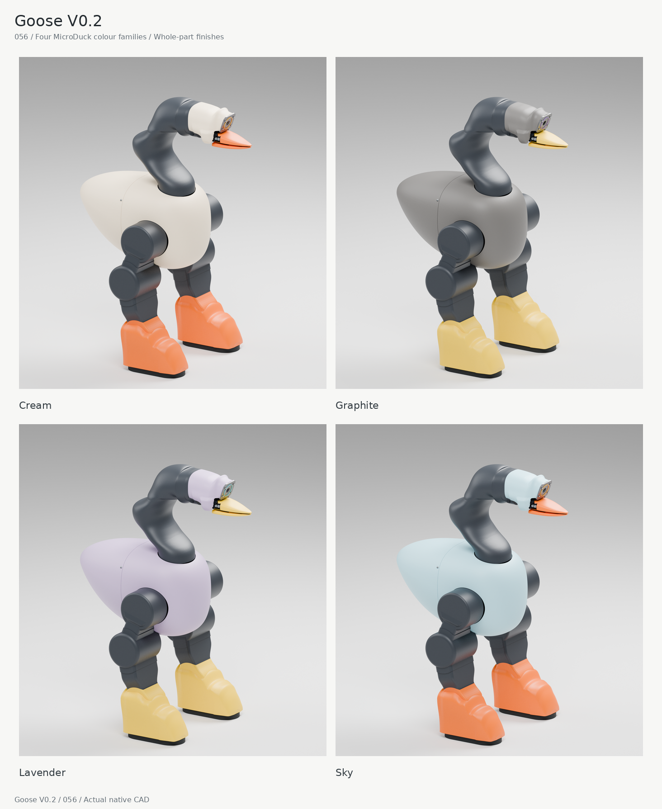

# Goose V0.2

**本轮交付与训练接入冻结机体：[15](models/physics_v0_2_20261021_15_candidate/manifest.json)，设计质量16.869881kg，23刚体、18驱动、28外部凸碰撞体。** [同版头部闭合](cad/exports/hardware_closeout_040/candidate15/full_head_closed.step.gz)／[张开CAD](cad/exports/hardware_closeout_040/candidate15/full_head_open.step.gz)为137件原生装配；相对14仅替换下嘴内部承力筋和配合内腔两件，净增0.229g，完整鹅嘴、连续TPU、轴系、摩擦与原4.4N·m输入上限保持。[实际开闭与内部对照](images/bill_lower_preload_patch_048/native_head15_external_internal_comparison.png)已审查。仅按真实零件更新质量、重心与完整惯量。

**最新外观工程：[056连续包覆原生CAD](design/enclosure_refinement_056.md)。** 054造型方向已落实到真实装配：保留横向芒果母面与完整鹅嘴，收口圆髋、头颈接收边、膝部和整鞋上罩；机尾维护复位件移入可拆尾盖内部。原承力件和脚底继续保留，实际踝前承座干涉另以真实零件修正。单色设计先经过同版多视图检查，再按完整真实分件配色。

**056脚罩不能宣称不影响活动范围。** 有界原生动作复核已在10°／20°姿态检出软鞋皮穿入刚性小腿罩与AP电机包络的运动路径。现结构需要未验证的滑移或变形，随动接口正在改型；本页图片是静态外观。[实际复核](evidence/enclosure_refinement_056/ankle_motion/ankle_motion_review_056.json)与[侧摆−20°近景](images/enclosure_refinement_056/ankle_diagnostic_ar_neg20.png)保留。原金属、脚底、关节范围及冻结15未改。

[排除鞋罩的原硬件端点独审](evidence/enclosure_refinement_056/ankle_motion/baseline_endpoint_review_008.json)发现，左AP在+1.1／−1.1 rad时，原7075承力件与原小腿承力壳分别相交约274.576／1155.931 mm³；[零位核对](evidence/enclosure_refinement_056/ankle_motion/baseline_zero_reference_check_008.json)排除了角度偏置。另查的AR底板／钢集流件在±0.5 rad均有2.08 mm间隙，仅适用于这一对零件。这些结果分别归因，不豁免新鞋罩的冲突，也不构成全部原硬件ROM验收。修正另留候选，原冻结包不热覆盖。

[单色三视图](images/enclosure_refinement_056/clay_three_views.png) · [头颈／踝鞋／后跟](images/enclosure_refinement_056/clay_interface_details.png) · [Cream／Graphite／Lavender／Sky](images/enclosure_refinement_056/four_colorways.png) · [完整原生STEP压缩包](cad/exports/enclosure_refinement_056/goose_enclosure_refinement_056.step.gz) · [逐件源与装配清单](cad/source/enclosure_refinement_056/assembly_manifest.json) · [验收证据](evidence/enclosure_refinement_056/delivery_review.json)

056与上面的冻结运行包15分别保存，未改变训练物理。柔性罩的变形、固定与寿命，完整运动范围和制造资格均按[同版边界](design/enclosure_refinement_056.md)报告。051零碎配色与052未闭合外壳保留作历史拒绝记录；当前配色使用既有MicroDuck色值及完整零件，不再增加任意翼斑、腹带或颈前色块。交付遵循[设计审查门槛](design/delivery_review_gate.json)。

**当前没有通过连续5秒的可吊重量结论。** 016的20kg曾真实离台0.3205s；13的3N·m／4.4N·m试验仍滑回托台，10kg也被旧上嘴扭转筛查截停。14采用真实下嘴局部补强，并计入已存在的连续上嘴筋，原材料许用值不变。上述失败完整保留，不能把旧载荷回放筛查或瞬间约196N支撑冒充14已通过。同14机体下021默认NoSlip0最长实际全载仅0.133s，022／023未完成捕获，024／025在捕获中触发原25µm闭环门；均未获5s资格。另行026／027改变切向有效柔度的敏感性试验先触发原38N止推条件门，也未完成保载；它们不能冒充原物性或实机通过。按用户纠正后的032已真正一次咬合连续增重0.167→5.260kg，托台撤离；随后滑出真实工作面域。末输入仅1.520N·m，尚未达到4.4N·m；5.260kg是本次增载协议的域退出点，不是硬件额定或5s保持上限。[独立实际审计](../../experiments/goose_v0_2/continuous_hanging_load_047/actual032_independent_virtual_ramp_audit_001.json)记录524次质量／惯量更新及零姿态改写。033同协议已实际达到原4.4N·m，并连续使用0.7985s；总挂载增至4.217kg时，下嘴237mm截面的原条件强度筛查先触发（利用率1.00504），尚未脱嘴。夹持预紧法向约254.6／250.5N不能当作悬挂重量；4.217kg也不是额定或5s保持上限。[实际032／033对照](../../experiments/goose_v0_2/continuous_hanging_load_047/actual032033_fullinput_comparison_001.json)与[完整视频及曲线索引](evidence/hardware_closeout_040/candidate14/continuous_virtual_load_047/actual_video_curve_index_032_033.json)保留。15已完成独立几何／物性审核及同协议034回归：原4.4N·m保持1.293s，连续增载至5.210367kg，下梁254mm截面原条件强度筛查先触发（利用率1.00360）；托台已撤离、接触仍在工作面内，但持续滑移。停止载荷比14／033提高约23.55%，不能将其签为额定或连续5s悬挂能力。本轮按用户接受的约5kg级增载实验结果收尾，不再追加改型；全开度满输出的已知薄尾边界仍保留。

[15运行ZIP](evidence/hardware_closeout_040/candidate15/candidate15_runtime_only.zip) · [交付及使用范围](evidence/hardware_closeout_040/candidate15/README.md) · [独立便携加载](evidence/hardware_closeout_040/candidate15/portable_zero_step_receipt_001.json) · [034完整视频与实际曲线索引](evidence/hardware_closeout_040/candidate15/actual034_video_and_curve_index_001.json)。完整原生CAD以压缩STEP交付；材料、加工、摩擦／顺应、热与寿命仍须实测。验包使用[兼容验证入口](../../scripts/evaluation/verify_goose_physical_package_040.py)，冻结包内继承的旧verify程序不支持当前清单格式，不作为本版验收入口。14及04保留。

**训练机体与I/O自验通过：** [独立入口与用法](evidence/training_io_049/README.md)提供18维归一化电机目标、65维状态观测、显式reset、20ms步进，以及RGB／语言／动作序列读写；[最新实际验收](evidence/training_io_049/smoke_002/receipt.json)完成2次reset、100动作／2秒物理推进，并将0.92秒图像和执行前状态与随后4个真实动作逐值、逐时对齐，[独审通过](evidence/training_io_049/smoke_002/independent_alignment_review_002.json)。物理与I/O可供PPO／VLA训练接入；任务、奖励、终止条件和完整训练器由调用方提供，本轮未启动训练。原08检查点不兼容新的真实输入轴5。当前RGB为已声明的碰撞代理调试视角，相机实机标定与真实外观视觉仍需另行接入。

原默认[04](models/physics_v0_2_20261018_04/README.md)继续保留为不可覆盖对照：14凸体、547支持点／1038凸面。新训练必须显式选择上面的15 ZIP及其manifest身份，不能无声沿用旧08策略或替换正在运行的任务。

整机020只实际完成0.20s侧向准备，COM左移0.252mm，无饱和或脱嘴；因Owner未及时续发在原预算前封存，不能称控制失败或换撑通过。**受载换撑、连续0.5m／0.1m/s及停车留嘴3s均未通过。** 最新版本、实际停止及源哈希见[015唯一执行记录](../../experiments/goose_v0_2/gpt_driven_backward_015/order.json)；04默认不替换，零PPO／GPU，旧定时任务继续暂停。

[GPT 驱动 Goose：控制思路复盘与最小实验](design/agent_control_research_014/gpt_driven_goose_control_review.md)：2026-10-20 只读调研，模型按用户要求固定 GPT‑6.1 Sol；先核实持续倒退/停稳，再评估高层反馈与恢复。未集成、未恢复仿真或训练，未变更默认机体与物理合同。

用户随后已授权[015 GPT 驱动受载拖拽执行](../../experiments/goose_v0_2/gpt_driven_backward_015/order.json)：08作为不可变对照，硬件改型另发候选；GPT‑6.1 Sol读取实际状态和接触反馈、选择下一段身体／双脚／头颈动作，由IK与原驱动执行后再反馈。按最新指示先真实咬住装20kg货物的cart004低拉杆，双足蹬地、后倾持续牵引；空载步行不再是载车验证的前置门槛。最终指标仍为连续后退≥0.5m／≥0.1m/s、制动后稳定留嘴3s，小滑移允许恢复。曾额外执行的5分钟PPO未产生真实步，已停止且不续训。必须以完整物理轨迹和带车连续视频验收；旧009暂停记录、旧长期训练及定时任务保持原状。该执行尚未通过整项目标，04默认发布包不变。

[20kg货物＋7.815kg车重的首轮测力](evidence/gpt_driven_backward_015/loaded_grip_measurement_001.json)：原q-only闭合在当前咬位约29.0／26.7N；显式闭合力矩控制使用原4.4Nm上限后的独立1秒稳态约60.0／57.6N（此前61.1／58.8N为过渡段），两面分列、不相加冒充牵引力。原平行站姿曾产生37.62N瞬时后拉，随后踝关节先到6.4Nm上限并失衡，完整失败保留；未通过稳定半米拖运，也未测得拉脱极限。08上下嘴运行凸网格与04相同。旧V0.1圆肋方案的重物失败仍须正视，Owner此前提出直接复用的判断已撤回；09圆肋夹持试验仅保留作未采用历史，不能作为本轮新改型交付。全部为MuJoCo结果，未授实机或制造资格。

本轮改型已由用户确认边界：保持像鹅的外观与鹅嘴整体外形，优化内部夹持、传动和承力结构；纯物理接触，真实硬件持续能力与质量一致，避免无谓增重，整机拖拽保持平衡并允许小滑移恢复。主线是交付有效硬件改进。003中的20kg货物由车板/车轮承重，嘴水平牵引峰38.38N、1.4–2.2s均10.51N，嘴接触穿入最大2.60mm；不能用它认证20kg悬挂或真实夹持极限。车轮阻力与俯仰弹簧为未实测的历史实验假设。原嘴隔离台架首次试验又暴露零外载预夹漂移及3.51mm穿入，仅用于定位改型问题，不作能力通过。

**嘴部当前方向：保留完整鹅嘴和连续通用夹持面，改内部真实变比传动、承力和双侧支承。** C03/r09挖槽专用杆夹已撤回。[完整原生头部r07](cad/exports/full_native_head_integration_026/r07_fork_c02_review/full_head_closed.step)已合并136件，原头壳、上下嘴和TPU来源保持；整机名义估算16.86652kg，比08净增138.07g，含轴承目录惯量和M3加工包络近似。固定头部025第三窗使用原4.4Nm，真实离台2.1245秒、严格双面1.67秒后接触移出已审材料工作域；尚未完成可靠保持。[最终独审](../../experiments/goose_v0_2/variable_gain_drive_029/actual_r07_window003_diagnosis_001.json)确认锥内约1mm/s滑移与软摩擦数值项吻合，不能据此继续挖嘴或盲增力。另行完成的六工况接触数值核查未改变Goose模型，也不授硬件资格。新轴套损耗、自由销浮动、实物及通用物体能力仍未实测，整机半米拖拽未通过。默认04与原08保持不可变，未恢复PPO或定时任务。

**上一执行机体：[10完整r07整机](models/physics_v0_2_20261021_10_candidate/manifest.json)。** 23刚体、18驱动、28外部凸碰撞体，质量16.86652kg，完整嘴部外形与原执行器上限保留；axis5是真实输入电机坐标，旧08策略不兼容。006已从冷源执行至4.920s：带7.815kg车及独立20kg货物，真实咬持后完成0.24s控制接口切换及0.30s双足准备，CoM下降3.047mm、双嘴各约32.8N、双足承重保持，未剪裁执行器力矩、无隐藏外力或新增非法承载。尚未换步或拖运。世界头部8.235mm误差不能直接当脱嘴，车杆也随动；杆坐标中相对TCP差约0.0012mm。独审定位原LP借微小闭环残差放大出虚假neckyaw力矩，旧FF已停用，新物理切空间投影可重现实际头力矩；下一整机参考须按真实足滑、共享法向和原轴能力核查。所有实际窗口已结束，半米／0.1m/s／停车留嘴3s未通过；04默认不变，零PPO/GPU，不恢复定时任务。

**历史有限执行候选：[11](models/physics_v0_2_20261021_11_candidate/manifest.json)。** 真实033止推零件及MCI已合入[完整头部CAD](cad/exports/full_native_head_integration_026/r08_thrust033_identity_r02_review/full_head_open.step)，净增2.613g至16.86914kg，仅头部固定体与下嘴体的MCI变化；全部外部碰撞网格、嘴壳、连续夹持垫、轴位、电机、摩擦和驱动代码保持。止推条件筛查26.4186N对应实际材料采购与尺寸，不能当嘴夹力或拖力。007已从冷源执行4.7985s，在原4.4Nm上限内达到实际输入2.50139Nm、上／下夹持法向199.827／199.192N，双足保持承重，随后原上嘴截面条件筛查先退出；没有达到4.4Nm或完成满力矩保持。原停止记录保留，正在按真实STEP复核旧筛漏计的既有高脊，不能把条件筛退出称作实物断裂，也不能把每面199N称作牵引力或20kg悬挂能力。制造公差、旧相机螺钉包络、根部机构外露和CAD布尔可靠性边界仍保留；通用物体夹持、整机半米拖运及稳定训练资格均未通过。

不可变对照源为[08原生硬件候选](models/physics_v0_2_20261020_08_candidate/README.md)：**16.728453580kg、23刚体、18驱动、28凸碰撞体**，实际加载1565支持点／3018凸面。[同版原生整机三视图](images/drag_hardware_integration_009_08/whole_source_review_01/whole_three_views.png)与[硬件交接](evidence/drag_hardware_integration_009_08/integration_handoff_08.json)对应。两枚真实AK45-10髋偏航电机与H900 Oldham件合计比07增144.555g，整条偏航链硬帽1.8Nm、禁峰，其余轴不变。08同控制器回归尚无合格迈步／半米拖运；从张嘴真实捕获并保持5秒取得有限观察证据，但0.5mm接触压入与严格内区接触门槛仍未通过。**08是探索候选，未替换04默认入口，未授稳定训练或制造资格。** 08历史交接与执行决定保留于[009协调记录](../../experiments/goose_v0_2/drag_hardware_sprint_009/coordination.json)。

[08独立运行ZIP](models/physics_v0_2_20261020_08_candidate.zip) · [SHA256](models/physics_v0_2_20261020_08_candidate.zip.sha256) · [解包加载核查](evidence/drag_hardware_integration_009_08/owner_archive_readback_08.json)。ZIP只含不可变08物理输入；1000Hz原生子步、脚底box数值适配及本轮Teacher控制器属于另行绑定的Sai_Lab实验配置，不能把独立包的默认时序当作整机拖运实证。

[原四处飞面逐点对照](images/display_surface_audit_012/c01/whole_and_four_original_regions.png)及[源／网格核查](design/display_surface_audit_012/c01/engineering_review.md)：旧长飞片已从08显示网格中移除；髋口裁边、脚罩口沿与前壳风道边界仍是真实原生几何，未宣称完整外观或制造修复。同源细化显示只用于审核，没有改变08原生、质量或物理包。

04只替换碰撞代理。物理合同、执行器合同、逐项质量账和运行适配器与02逐字相同；设计总质量16.970203929 kg、23个刚体、18个控制轴、4个内部机械坐标，驱动/物理200 Hz、策略接口50 Hz。代理不参与质量计算，完整惯量、轴系、闭环和连续扭矩/速度/电源降额仍来自硬件合同。原生CAD、硬件资料和02源文件未改。

- [运行说明与唯一加载入口](models/physics_v0_2_20261018_04/README.md)
- [物理合同](models/physics_v0_2_20261018_04/physical_contract.json) · [执行器合同](models/physics_v0_2_20261018_04/actuator_contract.json) · [逐项质量账](models/physics_v0_2_20261018_04/mass_ledger.json)
- [凸块来源与机械相邻例外](models/physics_v0_2_20261018_04/collision_manifest.json) · [源身份](models/physics_v0_2_20261018_04/source_snapshot.json)
- [实际碰撞体三视](images/physics_v0_2_20261018_04/runtime_contacts_three_views.png) · [可旋转GLB](models/physics_v0_2_20261018_04/preview/runtime_contacts.glb) · [OBJ](models/physics_v0_2_20261018_04/preview/runtime_contacts.obj)
- [独立解包及硬件数据不变核对](evidence/physics_v0_2_20261018_04/independent_release_gate.json)
- [直接原生CAD夹持轮廓检查](evidence/physics_v0_2_20261018_04/independent_native_grip_contour_sealed_source.json) · [关键接触检查](evidence/physics_v0_2_20261018_04/independent_critical_contact_sealed_source.json)
- [接触参数与Sim2real标定边界](evidence/physics_v0_2_20261018_03/sim2real_contact_boundary.json) · [硬件续办](hardware/training_physics_20261018_followup.md)

真实下夹持面侧前缘在03中漏覆盖4.041mm，已作为[真实CAD拒绝用例](evidence/physics_v0_2_20261018_03/native_contact_reference_check.json)保留。04只在原下喙凸块补入已采用TPU垫的真实平面边界，其余13个OBJ与03逐字相同，不增碰撞块、不改变硬件数据。两份小原生BREP和可重放轮廓随源保存，采用身份由原生质量/COM与whole05保存面放置相互核对。

有限直接CAD复核中，下夹持轮廓在数值精度内吻合、无虚增凹口或孔区；上夹持轮廓最大缩入约0.025mm，脚底约0.524mm。上下真实夹持平面、嘴部真实物体、双脚地面、有限颈部姿态及身体–小腿/跨脚阳性检查另有记录。只有明确机械相邻的6对例外，非相邻自碰保留。原整机2.4315mm/躯干6.9954mm数值是相对02父代理的有限方向差，不能当作相对native CAD或实体的绝对误差，更不是全ROM认证。

最终04同MuJoCo3.10、固定CPU的原生步进中位值约19.8–33.3微秒；参考驱动适配器在400步检查中平均约0.184毫秒/物理步。对同一硬件291块模型，最终04碰撞查询快42.8–48.4倍。旧14的1.5倍相对成本目标未获放行，03历史对照中部分姿态慢约2倍的拒绝结果保留，04不宣称该目标已达。GPU和批量训练吞吐未测，不宣称全任务或旧版同吞吐已验证。

摩擦系数0.65与接触柔度仍是设计假设，condim3未实证滚动/扭转阻力；接触几何通过不等于真实抓持力、地面牵引或温度/磨损响应已标定。实物质量/COM/惯量、摩擦柔度、电机力矩速度与延迟仍须台架实测。后续标定若改变物理合同或接触则另发版本，不热覆盖本包。

当前按[稳定夹持、100g举起与倒退拖运验证方案](design/grasp_lift_drag_validation.md)推进硬件优化：Rotbots本聊天负责机体/低矮理货车、V0.2拖拽验证及证据决策，数据归Sai_Lab独立V0.2入口维护；既有Picking聊天负责V0.1，不再承接拖拽或购物车任务。目标是在像鹅的外观约束下提高真实可持续载重/拖拽能力，正式重载超过16.9702kg自重，低矮理货车首版按20kg有效货物载荷设计、车重另计；带轮车和无轮滑块分榜，100g举起保留基础回归。第一单[局部夹持审核](evidence/grip_100g_pilot_001/pm_review.md)与第二单[0.5–4kg前置拖运审核](evidence/ground_drag_load_002/independent_review.json)保留失败证据，尚未证明20kg或完整整机拖运；04输入未变。GPU与训练更新为零，旧长期训练和定时任务保持暂停。02的291块及03漏边版本不作为当前入口。

低矮理货车当前选用[低把手03工程候选](evidence/low_profile_stock_cart_03/design_review.md)：[实际模型对照](images/low_profile_stock_cart_03/grip_height_comparison.png)中杆心由480降至420mm，与自由俯仰枢轴同高；前端保留10°嘴部避让，消除上一斜杆稿的额外下压力。空车设计估计7.815342kg（含0.35kg硬件预留），20kg指目标有效货物、另加车重。原生质量/完整惯量与接触代理分开维护；新版004车20块＋鹅14块＝34块，地面另计，当前无货物实例。

将两版拉杆自重都计入20N理想静拉，最大持续力矩利用率约68.56%→62.00%；仅授指定姿态比较。02/003斜杆原型的“实际减负”结论已撤销，保留拒绝证据。20N加3N侧力仍超持续限制，夹持、20kg动态拖运和转弯未验收；鹅04冻结输入保持原版。

嘴部硬件验证采用用户指定的GPT‑6.1 Sol Teacher＋IK，零PPO。005完成5次局部试验；[006审核](evidence/cart_drag_probe_006/pm_review.md)完成4次，接受声明工装下约35.8mm纯接触后拉与5.18s双侧留嘴的有限证据。完整进场仍先碰车架转轴并预推，尚不足决定嘴部改型；04硬件保持。全路径避让核查与双足倒退准备并行，游戏3:54拖篮/9:01拖袋是全身动作目标，固定躯干短拉不作整机拖运通过。

[007整机后坐审核](evidence/cart_drag_whole_body_007/pm_review.md)：3次空载真自由根试验，有限实现腿驱动身体后移约20mm、双足保持2秒并返回；原5mm足滑资格线未过，末次仅作事前声明的完整诊断，未放行受载。当前未完成整机拖车或连续倒退，机体质量/惯量/驱动和14叶碰撞保持04原版。

按用户“车呢、连续向后走做了吗”的纠正，[008带车审核](evidence/cart_drag_loaded_diagnostic_008/pm_review.md)已完成6次／6357步真自由根、完整车与20kg货物同场试跑。**连续倒退仍失败，真实后退步数0，未完成0.5m或保持3秒。** 最长车后移约39mm来自颈牵拉并随后脱嘴失稳，不算整机运输。当前关键路径为原能力内真实承重转换，不能把计划相位或咬持当完成；原04硬件与14叶代理不变，零GPU／训练，不恢复定时任务。

当前[009硬件与整机执行](../../experiments/goose_v0_2/drag_hardware_sprint_009/order.json)由用户授权12小时推进：真实20kg货车后退≥0.1m/s／≥0.5m并停车留嘴3s，净增重≤1kg；允许内部承力与传动重排，保留鹅形。控制因果诊断、腿部真实减重和嘴部接口并行，主Agent负责整机取舍；[实际状态](../../experiments/goose_v0_2/drag_hardware_sprint_009/coordination.json)不以局部结果代替整机通过。旧04继续作不可热覆盖对照，零PPO/GPU，不恢复旧定时任务。

[05原生硬件实验候选](models/physics_v0_2_20261020_05_candidate/README.md)已完成加载读回：16.6008308064kg、23刚体、18驱动、14凸体／547支持点／1038真实凸面；对照04轻369.373g。[源与集成交接](evidence/drag_hardware_integration_009/integration_handoff_current.json)保留完整MCI与有限验收边界。05尚未通过受载步行，未替换当前默认入口；主体避让凹面修正另存候选，不覆盖其物理数据。

[009独立动作审核](evidence/drag_mouth_interface_009/control_admission_009/review.md)确认05一次真实63ms离地及44.624mm后落脚；足滑、侧倾和下沉仍失败，不授稳定一步或拖运资格。

[实际姿态原生机械复核](evidence/drag_actual_foot_clearance_009/attempt_001/report.md)进一步发现：该失败运行三处姿态中，右AR罩与铝支座接触，前壳与左右小腿钢内盖有5处实体穿入。此前有限角度的正间隙不能覆盖这些实际姿态；05仍为有已知机械问题的对照候选。修正须另发机体，并同步核对低复杂度碰撞代理，不能靠删除自碰规避。

[06同版原生硬件检查点](evidence/drag_hardware_integration_009_06/integration_handoff_06.json)已封存，设计质量16.5911249267kg；[修复后的原生整机三视图](images/drag_hardware_integration_009_06/whole_source_review_01/whole_three_views.png)与该源、MCI对应。原14叶仍有凹腔误填和胫盖漏覆盖，完整新步态也暴露新的真实干涉，故06仅作可加载检查点，不作稳定训练或受载行走交付；下一07联合修正真实壳体与低复杂度碰撞，保持当前04默认入口。最新完整动作诊断仍未通过稳定换步或半米拖运，详见009协调记录。

[07同版原生硬件原型](evidence/drag_hardware_integration_009_07/integration_handoff_07.json)已封存：**16.5838988627kg，23刚体、18驱动、28凸体／1565实际支持点／3018凸面，单体最多64点**；[当前原生三视图](images/drag_hardware_integration_009_07/whole_source_review_01/whole_three_views.png)。Owner核对包内70文件和实际加载接口。有限保存点最大欠覆盖2.1212mm仅按2.13mm原型例外接受，原2mm目标FAIL；薄边、STEP与制造资格未通过。动作09已做100ms左脚离地和约73mm后落脚，但足滑、落地后偏航侧倾仍失败；未实现稳定交替行走、半米拖运或停车验收。默认04入口保持，07独立用于有限硬件回归，完整执行状态见009协调记录。
